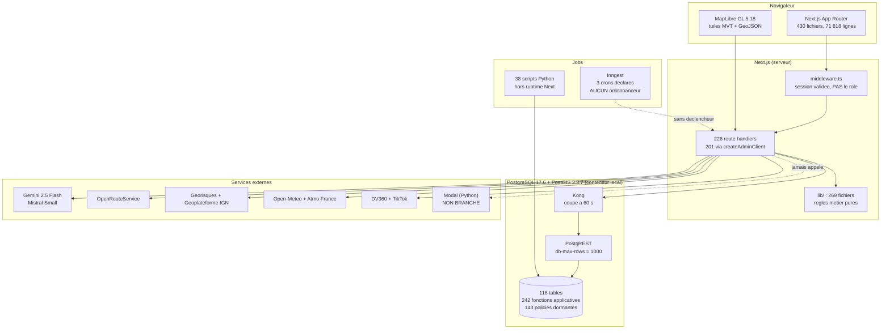
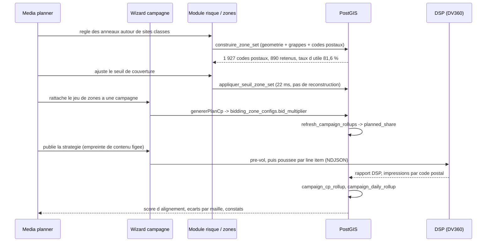

# Audit d'architecture MAGELIAN

> Audit externe, mené le **2026-09-22** sur la branche `main` (commit `89b62c02`).
> Mode lecture seule sur le code : aucun fichier applicatif modifié.
> Toutes les mesures de ce document viennent de commandes réellement exécutées
> ce jour, sur ce dépôt et sur la base locale. Les chiffres sont datés parce
> qu'ils bougent vite : le dépôt a gagné 19 routes API en six jours.

**Avertissement de méthode.** `ARCHITECTURE.md` a servi de point de départ, pas
de source. Chaque affirmation reprise ici a été revérifiée dans le code ou en
base. Cinq écarts ont été trouvés, dont un sur une règle d'autorisation
(section 3). Un audit qui se contente de reformuler la documentation ne vaut
rien, et celle de ce projet est trop bonne pour qu'on lui fasse confiance sans
vérifier : c'est justement ce qui la rend dangereuse.

---

## 1. Synthèse exécutive

MAGELIAN est un SaaS de géomarketing OOH/DOOH bâti sur Next.js 15 et
PostgreSQL/PostGIS. Le code est mature, dense, et documenté à un niveau très
au-dessus de la moyenne. La base technique est saine : compilation sans erreur,
1 802 tests verts, aucun fichier mort. Les risques ne sont pas dans le code,
ils sont dans l'exploitation : il n'existe plus aucune chaîne de déploiement ni
aucun environnement de production depuis le 2026-09-21, et plusieurs garde-fous
reposent sur de la discipline plutôt que sur des mécanismes.

**Trois forces.**

1. Les invariants coûteux sont verrouillés par des tests structurels qui lisent
   le code source, pas seulement son comportement (`tests/unit/carte/panneau-analyse-garde.test.ts`,
   `tests/unit/db/troncature-postgrest.test.ts`, `tests/unit/docs/derive-documentation.test.ts`).
2. Les règles métier délicates ont un corps unique, réutilisé par les deux
   côtés qui pourraient diverger (`lib/risques/affectation.ts` et sa
   transcription SQL croisée à chaque exécution par
   `tests/integration/affectation-sql.test.ts`).
3. La séparation des couches tient : aucun composant n'importe le client
   Supabase (0 occurrence dans `components/`), et deux composants seulement
   appellent une route en direct.

**Trois risques majeurs.**

1. **Aucun déploiement, aucune production, aucune CI.** Le seul environnement
   est un stack Docker local sur un poste. Les données irremplaçables ne
   tiennent qu'à un script de sauvegarde manuel (`scripts/local/10-sauvegarder.sh`).
2. **Une règle d'autorisation contredite par le code.** Le garde des routes DSP
   n'est plus réservé au super_admin, mais deux routes d'activation refusent
   encore les autres rôles au nom de cette réserve (section 3, écart n° 1).
3. **Trois troncatures PostgREST ouvertes**, dont deux avérées aujourd'hui :
   des écrans rendent des résultats incomplets sans le signaler
   (`tests/unit/db/troncature-postgrest.test.ts`).

**Maturité par axe, sur 5.** Ces notes sont des opinions, pas des mesures. Elles
reposent sur les constats sourcés des sections 3 à 7, et rien d'autre.

| Axe | Note | Ce sur quoi elle repose |
|---|:--:|---|
| Structure | 4 | Couches respectées, 0 fichier mort, 6 fichiers au-dessus de 1 000 lignes |
| Données | 4 | Modèle riche et documenté, 3 troncatures ouvertes, pré-calculs non versionnés |
| Sécurité | 2,5 | RLS dormante par conception, 1 écart d'autorisation, 1 route destructrice hors git |
| Tests | 4 | 1 802 tests verts, verrous structurels, aucune mesure de couverture de lignes |
| Exploitabilité | 1,5 | Pas de CI, pas de déploiement, pas d'ordonnanceur, sauvegarde manuelle |

---

## 2. Cartographie du système

### 2.1 Composants

Deux points que ce diagramme rend visibles, et qui n'apparaissent dans aucun
fichier de configuration :

- **Kong coupe à 60 secondes.** Toute opération synchrone plus longue échoue
  côté client sans que la base soit en cause. Une fonction de construction
  passait au-dessus de ce seuil jusqu'au 2026-09-22 : le remplissage des codes
  postaux d'un jeu de zones, mesuré entre 12 et plus de 400 secondes selon
  l'état du cache. Elle est redescendue à 7 secondes le jour même.
- **Modal n'est jamais appelé.** Le service d'inférence ML existe dans le dépôt
  (`modal/bidding_ml/`, 14 fichiers) mais sa variable d'URL est vide et sa
  table d'état est à zéro ligne. Décision documentée du 2026-09-22.

### 2.2 Flux d'une campagne, de bout en bout

Le point dur du produit est au milieu de ce flux : **le risque se mesure au
carreau INSEE de 200 mètres, le DSP achète au code postal**. Tout le module de
zones existe pour rendre cet écart mesurable, et le chiffre qui le porte
s'appelle le taux d'utile (population exposée rapportée à la population des
codes postaux achetés).

---

## 3. Écarts entre `ARCHITECTURE.md` et le code

C'est la section que les développeurs vérifieront en premier. Chaque ligne est
reproductible avec la commande ou le chemin indiqué.

| # | Affirmé dans la doc | Constaté | Fichier / commande | Gravité |
|:-:|---|---|---|:--:|
| 1 | Le garde de `/api/admin/dsp/dv360/targeting/push` est `isSuperAdmin` STRICT | Son garde est `requireDspAccess`, qui ne fait que `getUserFromRequest` : **aucun contrôle de rôle**. Le commit `92991042` l'a relâché volontairement (« DSP access scoping par organisation, plus admin-only »). Or `activation/prevol` et `activation/pousser` refusent toujours les non super_admin en citant cette réserve. Un `admin` de l'org propriétaire est donc bloqué par MAGELIAN sur une route qui l'accepterait | `lib/api/middleware.ts:51`, `app/api/campaigns/[campaignId]/activation/prevol/route.ts:91`, `.../pousser/route.ts:106` | **Élevée** |
| 2 | « le jsonb `metadata` des carreaux pèse ~806 o, le recopier ferait ~730 Mo » (justifiait de ne pas stocker la population à côté des distances) | Le chiffre visait le jsonb entier. Les 24 cibles seules pèsent **96 octets** par ligne, soit environ 100 Mo. La table porte désormais ces colonnes, et le remplissage d'un jeu passe de 12 à 400 secondes à **7,0 secondes** | `sql/229_population_du_carreau.sql`, corrigé le 2026-09-22 | Moyenne (corrigé) |
| 3 | `remplir_zone_set_cp` s'exécute en 48 ms | Elle rendait la durée de `appliquer_seuil_zone_set` : le retour était `jsonb_build_object(...) \|\| appliquer_seuil(...)`, et `\|\|` fait gagner l'opérande de droite. Durée réelle mesurée au chronomètre extérieur : 15 secondes | `sql/226`, corrigé le 2026-09-22 | Moyenne (corrigé) |
| 4 | Le référentiel des codes postaux permet d'attribuer un carreau à un code postal | `ref_codes_postaux` porte la **même géométrie** pour tous les codes postaux d'une commune. `ST_Equals` entre les contours de deux codes postaux nantais répond `true`. 71 groupes, 181 codes postaux concernés. Le départage « centroïde le plus proche » était donc une égalité parfaite, tranchée par l'ordre physique des lignes | `sql/228_regle_unique_carreau_cp.sql`, corrigé le 2026-09-22 | Moyenne (corrigé) |
| 5 | « 224 routes sur le disque, 223 suivies par git » (mesure du 2026-09-22 matin) | **226 et 225** le soir du même jour | `find app/api -name "route.ts" \| wc -l` | Faible |

**Ce que ces écarts disent du projet.** Quatre sur cinq portent sur des chiffres
de performance ou de volumétrie, et trois ont été corrigés le jour même de
l'audit. La documentation est tenue, mais elle vieillit à la vitesse du code.
L'écart n° 1 est d'une autre nature : c'est une règle d'autorisation qui a été
assouplie dans le code sans que les deux appelants qui s'y réfèrent soient
mis à jour. Ce n'est pas une faille (le refus est plus strict que nécessaire),
c'est une fonctionnalité bloquée par un commentaire périmé.

**Ce que la documentation dit juste, et qui a été vérifié.** Aucune route
n'instancie de client Supabase avec la clé publique (une seule la nomme, pour
vérifier sa présence). Les tuiles de zones de risque ne sont effectivement pas
en cache `immutable`, contrairement aux autres. Les 41 tables dont la RLS est
active sans policy sont un refus par défaut assumé, pas un oubli.

---

## 4. Analyse par couche

### 4.1 Présentation (`app/`, `components/`)

430 fichiers et 71 818 lignes pour `app/`, 126 fichiers et 28 398 lignes pour
`components/`. La frontière tient : **zéro** composant n'importe
`@supabase/supabase-js` ou `createAdminClient`, et deux seulement appellent une
route en direct plutôt que par un crochet.

Six fichiers dépassent 1 000 lignes, tous sur la carte :

| Fichier | Lignes |
|---|--:|
| `components/risques/AnalysePopulationOverlay.tsx` | 1 640 |
| `app/map/page.tsx` | 1 491 |
| `app/copilote/_hooks/useMapLayers.ts` | 1 334 |
| `components/ClusterDetails.tsx` | 1 198 |
| `app/copilote/_hooks/useMapInit.ts` | 1 112 |
| `components/risques/CarteRisque.tsx` | 1 090 |

Ce n'est pas anodin mais ce n'est pas du désordre : ces fichiers orchestrent des
instances MapLibre, dont le cycle de vie impose de garder ensemble le montage,
les couches et les effets. Le projet a déjà découpé un monolithe de 2 118 lignes
(`FilterPanel.tsx`) en quatre panneaux. Le même traitement s'applique aux deux
premiers de cette liste.

### 4.2 Route handlers (`app/api/`)

226 fichiers `route.ts` sur le disque, 225 suivis par git.

| Mesure | Valeur |
|---|--:|
| Routes déclarant `export const dynamic = 'force-dynamic'` | 225 / 226 |
| Routes important `zod` | 117 |
| Routes appelant `createAdminClient()` | 201 |
| Routes instanciant `createClient()` en direct | 5 |
| Routes utilisant la clé publique (anon) | 0 |
| Routes avec garde applicative (`requireAdmin`, `requireAuth`, `requireDspAccess`) | 183 |

**Ce qui est propre.** La convention est tenue à 225 sur 226. La validation Zod
couvre la moitié des routes, ce qui correspond à peu près aux routes qui
acceptent un corps (les autres sont des lectures paramétrées par la requête).

**Ce qui fuit.** Cinq routes instancient leur client Supabase à la main au lieu
de passer par `createAdminClient()` : `app/api/admin/campaigns/route.ts:18`,
`app/api/admin/import-geo/route.ts:48`, `app/api/custom-geo/list/route.ts:16`,
`app/api/custom-geo/stats/route.ts:10`, `app/api/digital/campaigns/route.ts:15`.
Toutes utilisent bien la clé de service, donc ce n'est pas un problème de
privilège. Mais aucune n'est typée `createClient<Database>` (elles perdent le
typage des lignes), et surtout aucune n'hérite du `cache: 'no-store'` que le
wrapper pose sur `fetch`. Ce réglage n'est pas cosmétique : le commentaire de
`lib/auth.ts:51` documente le défaut qu'il corrige, des `profiles.organization_id`
périmés relus depuis le Data Cache de Next après un changement d'organisation.
Ces cinq routes sont exposées à ce défaut.

### 4.3 Domaine (`lib/`)

269 fichiers, 30 052 lignes. C'est la couche la plus soignée du projet.

Le motif dominant est la **règle unique à deux formes** : un corps de calcul,
deux enveloppes. Il est appliqué au type de retour (`calculer_score_composite`
et sa jumelle `_jsonb`), à la granularité (`cp_des_points` ensembliste et
`cp_du_point` scalaire), et au langage (`lib/risques/affectation.ts` en
TypeScript, `classe_carreau_risque` en SQL, les deux croisées à chaque
exécution de la suite par `tests/integration/affectation-sql.test.ts`).

Ce dernier point mérite d'être souligné aux développeurs : **trois jumeaux
TypeScript/SQL antérieurs n'ont été croisés qu'une fois, à la main**
(`lib/analyses/score.ts`, `lib/campagne/alignement.ts`, `lib/qualite/verdict.ts`).
Un seul écart a été trouvé sur l'un d'eux plus tard, et il rendait 100 d'un
côté et 0 de l'autre sur un cas dégénéré. Généraliser le croisement automatique
aux trois est un chantier court et rentable.

### 4.4 Données (`sql/`, base)

**Les migrations vivantes sont les 205 fichiers de `sql/`**, pas les 43 fichiers
de `supabase/migrations/`, qui sont désactivés (`[db.migrations]` à `false` dans
`supabase/config.toml`). Un auditeur qui regarderait le second répertoire
décrirait un projet qui n'existe pas.

| Mesure en base (locale, 2026-09-22) | Valeur |
|---|--:|
| Tables | 116 |
| Vues | 2 |
| Fonctions dans `public` | 1 021 |
| dont fonctions applicatives (hors extensions) | 242 |
| dont `SECURITY DEFINER` | 162 |
| Policies RLS | 143 |
| Tables avec RLS activée | 113 |
| Tables avec RLS activée et aucune policy | 41 |

Les 41 tables sans policy ne sont pas un oubli : RLS active sans policy vaut
refus total, et ces tables (caches, pré-calculs, journaux) ne sont lues que par
la clé de service. C'est un refus par défaut, correctement appliqué.

**Le point faible est ailleurs : les pré-calculs ne sont pas versionnés.**
Six tables représentent plusieurs heures de calcul géométrique et ne sont dans
aucun dépôt : `carreau_risque_distance` (883 451 lignes), `carreau_risque_nature`
(1 446 552), `couverture_rayon_risque` (115 962), `unite_population_totale`
(35 031), `cp_population_totale` (6 009), `zones_risque_cache`. Elles se
reconstruisent, mais l'ordre de reconstruction n'a été écrit qu'après un
incident (`scripts/local/11-reconstruire.sh`, sept étapes).

### 4.5 Jobs

Trois tâches planifiées sont déclarées et enregistrées auprès d'Inngest
(`app/api/inngest/route.ts:12`) :

| Fonction | Planification | État réel |
|---|---|---|
| `civicDailyIngest` | 05h30 quotidien | Jamais déclenchée : Inngest appelle une URL publique, il n'y en a plus |
| `agentChatPurgeWeekly` | 04h00 le dimanche | Idem |
| `agentAutoPilotDaily` | 06h00 quotidien | Idem, **et elle appelle deux routes qui n'existent plus** |

Le dernier point est vérifiable : `lib/inngest/functions/agentAutoPilotDaily.ts`
appelle `/api/bidding/strategies/{id}/drift-detect-local` (ligne 109) et
`/api/bidding/strategies/{id}/recommendations` (lignes 121 et 171). Ces deux
répertoires sont absents du dépôt. Si un ordonnanceur était rebranché demain,
cette tâche échouerait en 404.

### 4.6 IA

Le copilote utilise le Vercel AI SDK avec deux fournisseurs interchangeables,
Gemini 2.5 Flash et Mistral Small (`lib/chat/providers.ts`). Les outils suivent
une règle simple et bien tenue : un fichier par outil dans `lib/chat/tools/`,
retour structuré, jamais de texte libre. L'orchestrateur multi-agents vit dans
`lib/agent/orchestrator.ts`.

L'inférence ML du bidding (`modal/bidding_ml/`, Python sur Modal) est le seul
composant hors Next.js. Elle est **volontairement débranchée** : la variable
d'URL est vide, la table d'état du modèle est vide, et l'audit du 2026-09-22 a
montré que les données d'entraînement manquent (aucune ligne de
`dsp_campaign_data` ne porte de `metrics` renseigné). La décision de garder un
générateur local est documentée.

### 4.7 Python

38 fichiers, répartis entre les imports hors ligne (`scripts/`) et le service
Modal (`modal/`). Le contrat d'interface est minimal : les scripts parlent
directement à Postgres, le service Modal expose trois points HTTPS. Aucun
runtime Python ne tourne dans Next.js, ce qui est assumé et signalé par un 503
explicite sur la route de clustering.

---

## 5. Sécurité et données

### 5.1 Authentification et autorisation

Le middleware valide une session (`middleware.ts:106` et `:120`) mais **ne
vérifie aucun rôle**. Le contrôle de rôle appartient donc entièrement aux
handlers. Trois gardes existent :

| Garde | Ce qu'elle vérifie |
|---|---|
| `requireAdmin` | `role === 'super_admin'`, strictement |
| `requireAuth` | Session valide, sans rôle |
| `requireDspAccess` | Session valide, sans rôle (identique à `requireAuth`) |

Conséquence à connaître : le préfixe `/api/admin` **n'implique pas** un contrôle
super_admin. Il implique seulement d'être connecté. Les quinze routes
`/api/admin/dsp/**` sont accessibles à tout utilisateur authentifié et se
protègent par un filtrage sur l'organisation, ce qui est un choix explicite
(commit `92991042`), mais que le préfixe d'URL contredit visuellement.

### 5.2 RLS

**Les 143 policies ne s'exécutent jamais.** Les 201 routes qui parlent à la base
le font avec la clé de service, qui contourne toute policy. La sécurité réelle
est celle du middleware plus le filtrage par organisation écrit dans chaque
handler.

Ce n'est pas un défaut en soi, c'est une architecture. Mais elle doit être dite,
parce que lire « 143 policies » sans cette précision laisse croire à une
couche de défense qui ne tourne pas. Deux pièges attendent quiconque
brancherait la clé publique un jour : trois policies nomment un rôle `editor`
qui n'existe plus, et huit tables de référentiel testent `auth.jwt() ->> 'role'
= 'admin'`, une condition qui ne peut jamais être vraie.

### 5.3 Validation des entrées

117 routes importent Zod. Le projet impose de passer par `lireCorps()` et
`lireFormulaire()` (`lib/api/valider-corps.ts`) plutôt que par `request.json()`
nu, et un test verrouille la règle. Une seule route y échappe, et c'est un
fichier explicitement protégé.

### 5.4 Secrets

Le test `tests/unit/securite/aucun-secret-en-dur.test.ts` balaie tous les
fichiers suivis, tous langages confondus, et recolle les littéraux concaténés
avant de chercher. Il passe (4 tests verts).

Un incident historique doit être signalé aux développeurs : une clé de service
a été commitée en clair dans sept scripts Python, puis retirée. **Elle reste
dans l'historique git.** Le projet qu'elle ouvrait a depuis été supprimé, donc
c'est aujourd'hui un identifiant mort. Un lecteur qui la trouverait dans
l'historique ne doit pas conclure à une fuite active.

### 5.5 Une route destructrice hors de git

`app/api/radio/data/route.ts` expose un `DELETE` qui efface les données radio
(cibles `emetteurs`, `radios`, `all`). Ce fichier **n'est pas suivi par git** :
le motif `data/` de `.gitignore` l'exclut. Il est donc hors revue, hors
historique, et un `git clean` l'emporterait. Ce qu'il efface inclut 569 698
liaisons radio qui n'existent nulle part ailleurs depuis l'arrêt du projet
hébergé. Vérifiable : `git ls-files --error-unmatch app/api/radio/data/route.ts`
échoue.

### 5.6 Exposition des tuiles

Les quatre familles de tuiles sont protégées par le middleware (préfixes
`/api/tiles` et `/api/tmja-tiles`), compressées en gzip, et mises en cache :

| Route | Cache |
|---|---|
| `tiles/[z]/[x]/[y]` | `immutable`, jusqu'à 24 h, version dans l'URL |
| `tiles/iris/[z]/[x]/[y]` | `immutable`, 24 h, version dans l'URL |
| `tmja-tiles/[z]/[x]/[y]` | `immutable`, 24 h |
| `tiles/zones-risque/[z]/[x]/[y]` | **non `immutable`**, 10 min client, 1 h partagé |

La dernière ligne est correcte et délibérée : la clé de cache est un profil, et
les zones sont reconstruites quand les sites changent, sans que le profil en
sache rien.

---

## 6. Dette technique

| ID | Constat | Preuve | Impact | Effort | Prio |
|---|---|---|---|:--:|:--:|
| D1 | Deux routes d'activation refusent les non super_admin au nom d'un garde qui n'existe plus | `activation/prevol/route.ts:91`, `pousser/route.ts:106`, `lib/api/middleware.ts:51` | Fonctionnalité bloquée pour les rôles `admin` et `client` de l'org propriétaire | S | **P0** |
| D2 | `get_zone_centroids` tronquée : 6 187 codes postaux demandés, 5 000 rendus, les 136 ultramarins dans la queue perdue. Aggravant : sans zone, `/api/meteo-geo` retombe sur la France entière | `tests/unit/db/troncature-postgrest.test.ts` | Une carte cadrée sur La Réunion affiche la météo de la métropole | M | **P0** |
| D3 | `codes_postaux_dans_bbox` tronquée : 6 051 attendus, 5 000 rendus | Idem | Choroplèthe pollen et qualité de l'air incomplète d'un code postal sur six, en silence | M | **P1** |
| D4 | `get_strategy_comparison_data` sans aucune borne, sur une table de 280 000 lignes par campagne | Idem | Bilan exécutif Gemini calculé sur un échantillon arbitraire | M | **P1** |
| D5 | Route `DELETE` destructrice non suivie par git | `.gitignore:45` | Hors revue, hors historique, effaçable par `git clean` | S | **P1** |
| D6 | `agentAutoPilotDaily` appelle deux routes supprimées | `lib/inngest/functions/agentAutoPilotDaily.ts:109,121,171` | Échec en 404 le jour où un ordonnanceur revient | S | P2 |
| D7 | Cinq routes instancient Supabase à la main, sans typage ni `cache: 'no-store'` | Section 4.2 | Exposition au défaut de cache documenté dans `lib/auth.ts:51` | S | P2 |
| D8 | 194 exports morts, 0 fichier mort | `npm run catalogue` | Bruit de lecture, surface d'API interne surdimensionnée | M | P2 |
| D9 | Deux dépendances de développement déclarées jamais importées (`@typescript-eslint/eslint-plugin`, `@typescript-eslint/parser`) | Idem | ESLint ne peut pas appliquer les règles TypeScript qu'il croit avoir | S | P2 |
| D10 | `pmtiles` reste dans `package.json` alors que plus rien ne l'importe | Idem | Faux signal sur la stratégie de tuiles | S | P2 |
| D11 | Upstash déclaré, jamais configuré : les quotas passent par un compteur en base | `lib/api/rate-limit.ts:123` | Aucun aujourd'hui (le compteur en base est le bon garde-fou), mais le code porte deux chemins | S | P2 |
| D12 | Nommage résiduel : `GENESIS` dans 49 fichiers contre `MAGELIAN` dans 161 | `grep -rl` | Confusion pour un arrivant, aucun impact technique | M | P2 |
| D13 | Six fichiers au-dessus de 1 000 lignes | Section 4.1 | Relecture difficile, conflits de fusion | L | P2 |
| D14 | Trois jumeaux TypeScript/SQL croisés une seule fois, à la main | Section 4.3 | Divergence silencieuse possible, déjà constatée une fois | M | P1 |

---

## 7. Tests et qualité

| Commande | Résultat |
|---|---|
| `npx tsc --noEmit` | **0 erreur** |
| `npm run lint` | **0 erreur, 4 avertissements** (tous `react-hooks/exhaustive-deps`) |
| `npm run catalogue` (knip) | **194 exports morts, 0 fichier mort, 2 dépendances inutilisées** |
| `npm test` | **exit 0.** Unitaires : 171 fichiers, 1 718 tests. Intégration : 10 fichiers, 84 tests |

**Attention à la commande de test.** `npm test` lance deux passes séquentielles
(`vitest run --project unit && vitest run --project integration`). Les lancer
ensemble prive PostgREST de processeur et fait échouer un test différent à
chaque exécution, avec un message qui ne nomme ni la concurrence ni la mémoire.
Ce n'est pas de l'instabilité, c'est une contrainte du stack local.

**Ce qui est testé, et bien.** Les invariants structurels : gardes de périmètre
câblées sur les six outils d'analyse, bornes de troncature PostgREST déclarées
pour chaque RPC tabulaire, dérive de la documentation, absence de secrets, pile
de fermeture des panneaux. Ces tests lisent le **code source** et pas seulement
le comportement, ce qui attrape la classe de défaut où un test isolé passe
pendant que le câblage réel est faux.

**Ce qui n'est pas testé.**

- **Aucune mesure de couverture de lignes** n'est produite ni suivie. Le nombre
  de tests ne dit rien de la proportion de code exercé.
- Les tests d'intégration **écrivent** dans la base (création et suppression de
  jeux de zones, appels de construction). Sur ce projet, la base locale est le
  seul environnement : la suite n'est pas rejouable sur une base de production,
  il n'y en a plus.
- Aucun test de bout en bout sur navigateur n'est automatisé.

---

## 8. Plan de remédiation

### Chantier 1 : quick wins, semaine 1

| Action | Livrable vérifiable |
|---|---|
| Trancher D1 : soit les routes d'activation acceptent les rôles de l'org, soit le garde DSP redevient super_admin | Un test d'intégration qui affirme le comportement retenu, et les commentaires des deux routes alignés sur le code |
| Fermer D5 : exception dans `.gitignore` ou retrait du bouton | `git ls-files` trouve le fichier, ou la route n'existe plus |
| Fermer D9 et D10 : retirer les trois dépendances inutiles | `npm run catalogue` annonce 0 dépendance inutilisée |
| Fermer D6 : supprimer les appels aux deux routes absentes | Aucun `fetch` vers une route inexistante dans `lib/inngest/` |

### Chantier 2 : structurel, mois 1

| Action | Livrable vérifiable |
|---|---|
| Fermer D2 et D3 : jumelles `RETURNS jsonb` pour les deux RPC tronquées | Le test de troncature ne déclare plus ces deux fonctions en dette |
| Fermer D14 : croiser automatiquement les trois jumeaux TypeScript/SQL restants | Trois tests d'intégration sur le modèle de `affectation-sql.test.ts` |
| Fermer D7 : faire passer les cinq routes par `createAdminClient()` | `grep -rc "createClient(" app/api` rend 0 hors du wrapper |
| Produire une mesure de couverture et la publier | Un rapport de couverture dans la CI, avec un plancher qui fait échouer la construction |

### Chantier 3 : cible, trois mois

| Action | Livrable vérifiable |
|---|---|
| Rétablir une chaîne de déploiement et un environnement distinct du poste de développement | Une URL de recette, un pipeline qui exécute `tsc`, `lint` et `npm test` à chaque poussée |
| Rebrancher un ordonnanceur pour les trois tâches planifiées | Les trois crons s'exécutent et laissent une trace |
| Sauvegarder automatiquement, hors du poste, y compris les pré-calculs lourds ou leur recette exacte | Une restauration d'épreuve réussie, documentée, refaite périodiquement |
| Fermer D13 : découper les deux plus gros fichiers de carte | Aucun fichier de `components/` ou `app/` au-dessus de 1 000 lignes |

---

## 9. Questions ouvertes pour l'équipe interne

1. **Hébergement.** Le projet n'a plus d'environnement de production depuis le
   2026-09-21. Quelle cible : retour sur une plateforme gérée, conteneurs chez
   dentsu, ou Supabase hébergé plus un hébergeur applicatif ?
2. **Autorisation.** Le préfixe `/api/admin` ne garantit pas le rôle
   super_admin. Faut-il renommer ces routes, ou rendre `requireAdmin`
   paramétrable par niveau et l'appliquer systématiquement sous ce préfixe ?
3. **Le tier `admin` n'existe pas en pratique.** Les branches de protection
   contre l'escalade sont écrites et inatteignables. Les réveille-t-on, ou les
   supprime-t-on ?
4. **Ordonnancement.** Inngest reste-t-il le choix, ou bascule-t-on sur ce que
   l'hébergeur retenu propose ?
5. **Pré-calculs.** Six tables représentent des heures de calcul et ne sont dans
   aucun dépôt. Les sauvegarde-t-on, ou fige-t-on la recette et le temps de
   reconstruction comme contrainte d'exploitation acceptée ?
6. **Multi-signaux.** Le produit décide aujourd'hui sur la géographie. Jusqu'où
   veut-on aller vers d'autres signaux, et avec quelles données ?
7. **Inférence ML.** Modal est dans le dépôt, débranché, sans données
   d'entraînement. On le retire, ou on ouvre le chantier d'ingestion DSP qui le
   rendrait possible ?
8. **Nommage.** `GENESIS` subsiste dans 49 fichiers. Renommage complet, ou
   convention assumée entre le nom du dépôt et le nom du produit ?
9. **Couverture de tests.** Quel plancher fixe-t-on, et sur quel périmètre ?
10. **Outre-mer.** L'INSEE ne carroie ni la Guadeloupe, ni la Guyane, ni
    Mayotte. Les écrans le disent, mais le produit ne sait pas y calculer de
    population exposée. Assume-t-on cette limite commercialement ?

---

## 10. Annexes

### 10.1 Routes API, par famille

226 fichiers sur le disque, 225 suivis par git.

Comptes obtenus par `git ls-files`, donc sur les 225 routes suivies. La
famille `admin/` inclut ses 15 routes DSP, listées à part pour la clarté.

| Famille | Routes | Garde dominante |
|---|--:|---|
| `admin/` (toutes) | 68 | `requireAdmin` (super_admin strict) |
| dont `admin/dsp/` | 15 | `requireDspAccess` (authentification, scope organisation) |
| `custom-geo/` | 28 | `requireAuth`, quota sur 6 d'entre elles |
| `digital/` | 14 | `requireAuth` |
| `poi-clusters/` | 13 | Middleware seul |
| `campaigns/` | 11 | `requireAuth` |
| `radio/` | 10 | `requireAuth`, 1 route hors git |
| `risques/` | 9 | `requireAuth`, quota |
| `bidding/` | 8 | `requireAuth` |
| `map/` | 8 | Middleware seul |
| `demo/` | 7 | `requireAuth` |
| `iris/` et `iris-crawler/` | 6 | Mixte |
| `zones/` | 6 | `requireAuth`, quota |
| `analyses/` | 5 | `requireAuth`, quota |
| `isochrone*/` | 4 | Middleware seul, 1 fichier protégé |
| `tiles/` et `tmja-tiles/` | 4 | Middleware seul |
| `agent/`, `user/` | 6 | Mixte |
| Autres (chat, meteo, ref, auth, inngest, providers, cibles, saved-maps, civic-indicators, insee-variables, smart-prompt, dsp, pilot) | 18 | Mixte |

### 10.2 Base de données

| Objet | Nombre |
|---|--:|
| Tables | 116 |
| Vues | 2 |
| Fonctions applicatives | 242 |
| Fonctions `SECURITY DEFINER` | 162 |
| Policies RLS | 143 |
| Migrations versionnées (`sql/`) | 205 |
| Préfixes de quota déclarés | 32 |

Tables les plus volumineuses en lignes : `carreaux_filosofi` (2 324 577),
`carreau_risque_nature` (1 446 552), `carreau_risque_distance` (883 451),
`emetteur_radio_stations` (569 698), `dsp_campaign_data` (477 879),
`poi_france` (390 029), `couverture_rayon_risque` (115 962), `iris` (49 448).

### 10.3 Dépendances

33 dépendances de production, 19 de développement.

| Paquet | Version déclarée |
|---|---|
| `next` | 15.5.25 |
| `react` | ^19.0.0 |
| `@supabase/supabase-js` | ^2.97.0 |
| `maplibre-gl` | ^5.18.0 |
| `zod` | ^3.22.4 |

### 10.4 Volumes de code

| Répertoire | Fichiers | Lignes |
|---|--:|--:|
| `app/` | 430 | 71 818 |
| `sql/` | 207 | 33 160 |
| `lib/` | 269 | 30 052 |
| `components/` | 126 | 28 398 |
| `tests/` | 182 | 20 683 |
| `scripts/` | 54 | 11 914 |
| `types/` | 8 | 8 777 |
| `modal/` | 14 | 1 116 |

### 10.5 Commandes exécutées

| Commande | Sortie résumée |
|---|---|
| `npx tsc --noEmit` | 0 erreur |
| `npm run lint` | 0 erreur, 4 avertissements |
| `npm run catalogue` | 194 exports morts, 0 fichier mort, 2 dépendances inutilisées |
| `npm test` | exit 0, 1 718 tests unitaires, 84 tests d'intégration |
| `find app/api -name "route.ts" \| wc -l` | 226 |
| `git ls-files "app/api/**/route.ts" \| wc -l` | 225 |
| Requêtes de catalogue sur la base locale | Voir 10.2 |

### 10.6 Variables d'environnement

`.env.example` déclare 32 variables. Le code en référence 27 distinctes. Deux
variables utilisées par le code manquent au fichier d'exemple : `NODE_ENV`
(fournie par le runtime, donc sans conséquence) et **`SUPABASE_DB_URL`**, qui
est une vraie omission : elle est lue par le client SQL direct de
`/api/admin/health`.

---

## Ce que je n'ai pas pu vérifier

- **Le comportement en production**, puisqu'il n'y en a pas. Toutes les mesures
  de performance viennent du stack local (PostgreSQL 17.6, conteneur Docker,
  `shared_buffers` à 128 Mo). Elles ne se transposent pas telles quelles.
- **Le palier de calcul et le débit disque provisionné** du projet hébergé
  historique : ils n'étaient lisibles que dans une console qui n'existe plus.
  Les contraintes d'entrées-sorties du code viennent de trois incidents réels,
  pas d'une valeur relevée.
- **La couverture de lignes des tests** : aucun rapport de couverture n'est
  produit par le projet, et en générer un modifierait la configuration, ce que
  le mode lecture seule interdit.
- **Les intégrations DSP de bout en bout** (DV360, TikTok) : elles demandent des
  identifiants et des droits côté annonceur que cet audit n'a pas.
- **Le service Modal** : son URL est vide, il est donc injoignable. Je n'ai pas
  pu vérifier qu'il est déployé, ni dans quel état.
- **La qualité des données elles-mêmes** au-delà des invariants déjà outillés
  par le projet (`/admin/qualite-donnees`). Un audit de données est un autre
  travail que cet audit d'architecture.

Deux mesures de ce document ont failli être fausses et ont été reprises :
un `grep` sur `immutable` avait trouvé le mot dans un commentaire qui explique
précisément qu'on ne l'utilise pas, et un premier recensement des gardes avait
oublié `requireDspAccess`, ce qui faisait passer quinze routes pour non
protégées. Les deux sont corrigées ci-dessus. Elles indiquent le niveau de
prudence à garder avec toute mesure obtenue par recherche textuelle.
