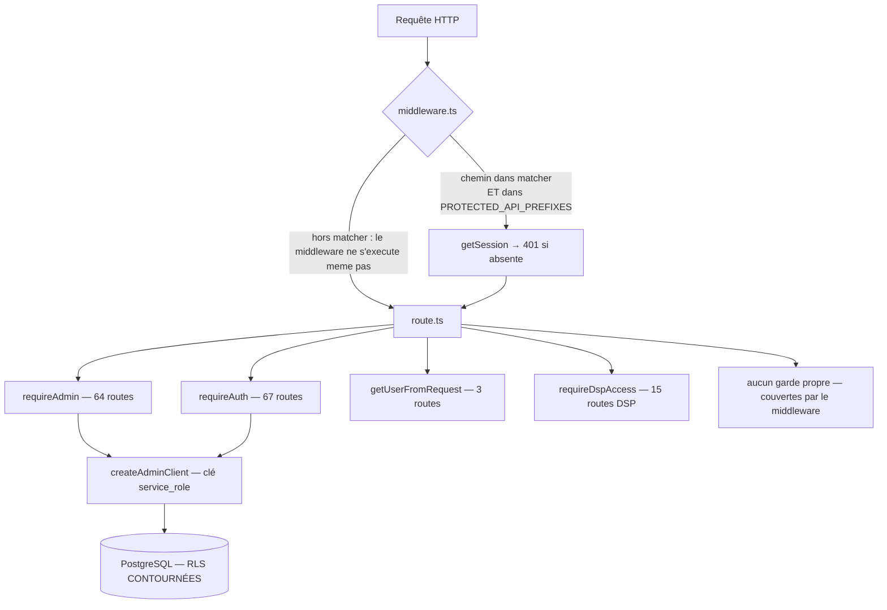
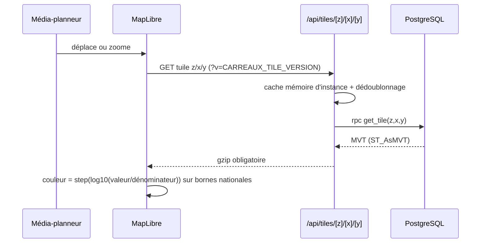
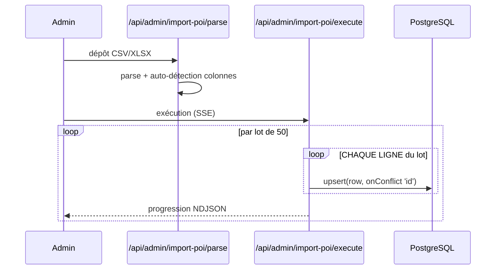
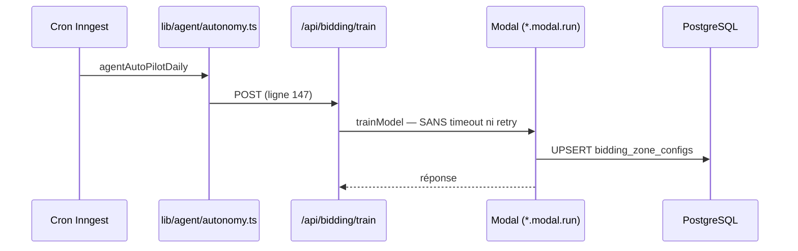

# Cartographie — reconstituée depuis le code

> ⚠ **2026-10-12 — Modal, l'agent d'enchères et `/api/agent/*` sont RETIRÉS**
> (chantier « suppression de toute l'IA », lot 2). Tout ce qui concerne
> `modal/bidding_ml/`, `MODAL_*`, `/api/bidding/train` ou l'agent dans ce
> document est historique. Source de vérité : `ARCHITECTURE.md`.

> Produite le 2026-09-11 par l'audit `/audit-refactor`, phase 1.
> **Ce document n'est pas la source de vérité de l'architecture** : c'est
> `ARCHITECTURE.md` à la racine, désigné par `CLAUDE.md`.
> Celui-ci est un relevé daté, orienté audit — il consigne le graphe réel, les
> écarts constatés et les chemins de données, avec citations `fichier:ligne`.
>
> **Pourquoi ce nom et pas `docs/ARCHITECTURE.md`** : sous Windows la casse est
> indifférente, `docs/ARCHITECTURE.md` et `docs/architecture.md` sont le MÊME
> fichier. Ce dernier était un doublon périmé (30/04) supprimé le 2026-09-11, et
> `tests/unit/docs/derive-documentation.test.ts` échoue s'il réapparaît.

## Vue d'ensemble

MAGELIAN est un SaaS B2B de géomarketing pour la publicité extérieure et
digitale. Un média-planneur y construit des zones de ciblage sur données INSEE,
puis exporte ou pousse ces zones vers des DSP (DV360, TikTok) et suit la
diffusion réelle. Tout passe par `/map` et ses overlays ; le back-office
d'administration est un onglet de ce même écran.

L'application est un monolithe Next.js déployé sur Vercel, adossé à Supabase
(PostgreSQL 15 + PostGIS). **Un seul composant échappe à ce monolithe** : un
service d'inférence ML en Python déployé sur Modal (`modal/bidding_ml/`).

## Stack

| Couche | Technologie | Version constatée |
|---|---|---|
| Framework | Next.js App Router | 15.5.25 |
| Runtime UI | React | ^19.0.0 |
| Langage | TypeScript strict | ^5.3.3 |
| Base | Supabase (PostgreSQL 15 + PostGIS), compute **Nano** | ^2.97.0 |
| Cartographie | MapLibre GL JS | ^5.18.0 |
| Tests | Vitest | ^2.0.0 |
| ML | Python sur Modal (hors Vercel) | — |

Dépendances : 32 en production, 18 en développement.

## Volumétrie

| Mesure | Valeur |
|---|---|
| Routes API (`app/api/**/route.ts`) | **170** |
| Pages | 29 |
| Fichiers `.ts` / `.tsx` (hors `node_modules`, `.next`) | 628 |
| Lignes TS/TSX | ~84 000 |
| Migrations `sql/` | 105 |
| Fichiers de tests | 64 (483 tests) |
| Tables PostgreSQL | 83 (+ 3 vues matérialisées) |
| Fonctions PostgreSQL hors PostGIS | 275 |
| Taille de la base | 7,1 Go |

## Points d'entrée

| Type | Fichier | Rôle |
|---|---|---|
| HTTP | 170 × `app/api/**/route.ts` | API applicative ; 169 sur 170 déclarent `export const dynamic` |
| Middleware | `middleware.ts:101-107` | Authentification centralisée (`supabase.auth.getSession()`) |
| Cron | `lib/inngest/functions/agentAutoPilotDaily.ts:54` | Pilote automatique quotidien |
| Cron | `lib/inngest/functions/agentChatPurgeWeekly.ts:11` | Purge hebdomadaire |
| Cron | `lib/inngest/functions/civicDailyIngest.ts:14` | Ingestion pollen + qualité de l'air, 05h30 |
| Webhook | `app/api/inngest/route.ts:9-12` | Réception Inngest, signé, exempté du middleware |
| Callback externe | `app/api/admin/dsp/dv360/oauth/callback/route.ts` | Retour OAuth Google |
| Callback externe | `app/api/admin/dsp/tiktok/oauth/callback/route.ts` | Retour OAuth TikTok |
| Service hors Vercel | `modal/bidding_ml/app.py` | 3 endpoints HTTPS `predict` / `train` / `detect-drift` |
| CLI | `scripts/*.py`, `scripts/populate_geom_3857.ts` | Imports et maintenance manuels |

## Modèle d'autorisation réel

**Le modèle réel, corrigé le 2026-09-11** : une route est protégée par le
middleware **OU** par un garde en début de handler, et il suffit de l'une des
deux. La plupart des familles récentes (`/api/agent`, `/api/bidding`,
`/api/custom-geo`, `/api/digital`, `/api/cibles`, `/api/user`) ne sont **pas
dans le matcher du tout** : le middleware ne s'exécute jamais pour elles, elles
s'appuient entièrement sur `requireAuth` / `requireAdmin`.

Vérifié par `tests/unit/api/routes-publiques.test.ts` : **les 170 routes ont
toutes au moins une protection**, sauf trois publiques assumées. Il n'y a aucun
trou aujourd'hui.

La fragilité subsiste néanmoins (`ARC-001`) : pour les routes qui dépendent du
middleware, il faut deux listes synchronisées — le `matcher`
(`middleware.ts:136-156`) et `PROTECTED_API_PREFIXES` (`middleware.ts:17-40`).
Le fichier le dit lui-même (`middleware.ts:128-131`) : « Une route absente d'ICI
n'est JAMAIS protégée, même si son préfixe figure dans PROTECTED_API_PREFIXES ».

**Les RLS sont dormantes** : 82 tables sur 83 ont `rowsecurity` activé et 154
policies existent, mais toutes les routes passent par `createAdminClient`
(`lib/auth.ts:35`, clé `service_role`) qui les contourne. L'autorisation
effective est celle du middleware plus les gardes de chaque handler.

## Graphe des couches — conforme

Vérifié, **aucune violation** :

- aucun module de `lib/` n'importe depuis `app/` (0 résultat sur 193 fichiers) ;
- aucun composant `.tsx` n'accède directement à Supabase ;
- **`createAdminClient` n'apparaît dans aucun fichier `'use client'`** — la clé
  `service_role` ne peut pas fuir au navigateur. Les deux seuls fichiers client
  touchant Supabase (`lib/auth-client.ts:1`, `lib/admin-fetch.ts:1`) utilisent
  `createBrowserClient` avec la clé anon publique.

**10 cycles d'import** subsistent dans `lib/` (aucun dans `app/`), tous dus à
deux patrons d'auto-enregistrement : le registre d'intents de l'agent IA
(`lib/agent/intents/index.ts:35-43` ↔ chaque intent important `registerIntent`)
et `lib/chat/tools/index.ts:47` ↔ `lib/chat/tools/schemas.ts:7`. Les huit
premiers passent par des `import()` dynamiques, donc sans crash au chargement.

## Flux de données

### Flux 1 — Affichage des carreaux INSEE sur la carte

Points clés : `app/api/tiles/[z]/[x]/[y]/route.ts:14-15` (cache par instance),
cascade à cinq paliers dans `get_tile` (`sql/129`), normalisation et bornes dans
`lib/carreaux/` (`normalisation.ts`, `bornes.ts`, `expressions.ts`), application
de la peinture dans `app/map/_hooks/useMapLayers.ts`.

### Flux 2 — Import universel de POI

**Deux défauts sur ce flux**, tous deux vérifiés de première main :
`lib/import/validator.ts:196` génère `id: randomUUID()` à chaque parse, donc le
`onConflict: 'id'` de `lib/import/inserter.ts:65` ne peut jamais s'appliquer
(`ECH-001`) ; et la boucle interne fait un aller-retour **par ligne** alors que
`CLAUDE.md` présente ce fichier comme le patron de batch (`PERF-002`).

### Flux 3 — Pilote automatique ML (le seul qui sort de Vercel)

`lib/bidding-ml/client.ts:68` appelle Modal sans `signal` ni reprise
(`ECH-002`), et `lib/inngest/functions/agentAutoPilotDaily.ts:105` avale les
échecs en « best-effort » (`MAINT-001`).

## Configuration

Les variables critiques sont listées dans `ARCHITECTURE.md` (tableau
« Variables d'environnement »), désormais gardé par
`tests/unit/docs/derive-documentation.test.ts`. Trois d'entre elles étaient
absentes de ce tableau jusqu'au 2026-09-11 : `MODAL_BIDDING_ML_URL`,
`MODAL_TOKEN_ID`, `MODAL_TOKEN_SECRET`.

## Écarts constatés entre l'architecture affichée et l'architecture réelle

| Écart | Réalité |
|---|---|
| `docs/architecture.md` annonçait « 70 tables — RLS partout » | 83 tables, RLS **dormantes**. Document supprimé le 2026-09-11 |
| `ARCHITECTURE.md` annonçait Next `^14.2` | 15.5.25 depuis le 10/09. Corrigé |
| `ARCHITECTURE.md` ignorait `modal/bidding_ml/` | 16 fichiers suivis par git, service vivant. Corrigé |
| `CLAUDE.md` : « batch par 50 (patron `lib/import/inserter.ts`) » | Le patron fait 1 requête **par ligne**. Voir `PERF-002` |
| `CLAUDE.md` : « validation Zod » sur les routes API | 38 routes POST/PATCH/PUT lisent `request.json()` sans schéma |
| Les dossiers suggèrent `lib/` = métier, `app/` = présentation | **Conforme** — aucune violation de couche trouvée |
