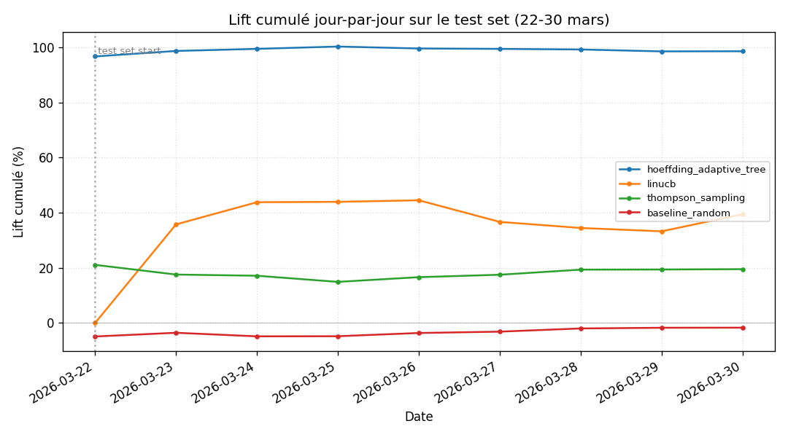
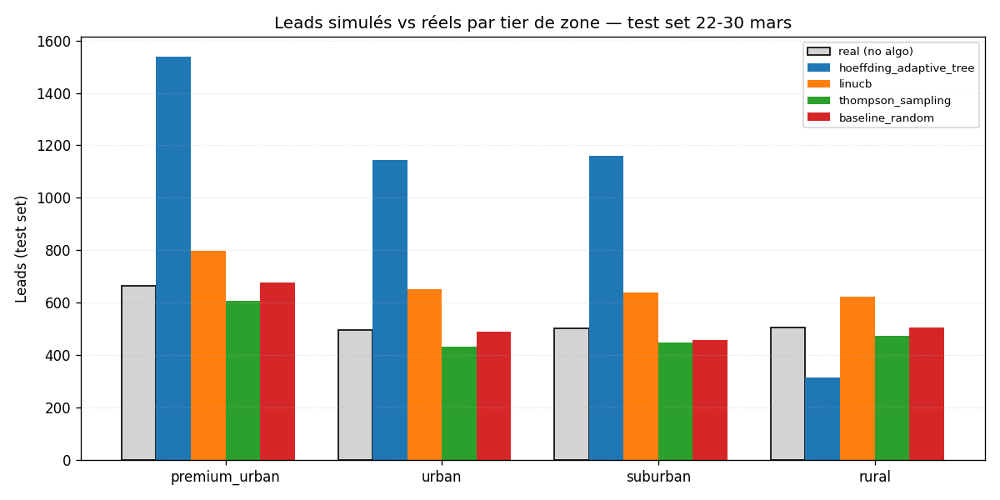
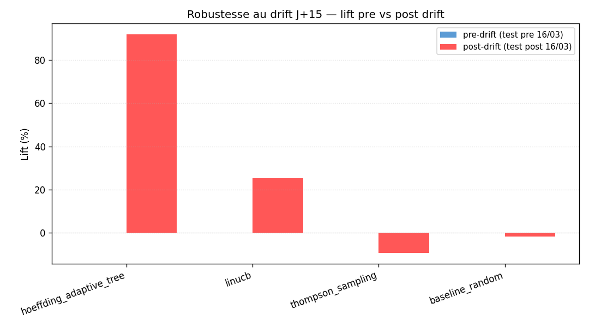

# Chantier A4.2 — Benchmark des 5 algorithmes ML

> Run : 2026-04-29 11:30 · Train : 2026-03-01 → 2026-03-21 · Test : 2026-03-22 → 2026-03-30

## 1 — Résumé exécutif

**Algo gagnant : `hoeffding_adaptive_tree`** — lift `91.97 %`,
 CPL `4.97 €` (vs réel `4.97 €`,
 Δ = `-0.01 €/lead`).

## 2 — Tableau comparatif

| Algo | Lift % | Leads sim | CPL sim € | Δ CPL € | Drift robustness % | Latency train ms | Latency predict ms (mean) |
|------|--------|-----------|-----------|---------|---------------------|------------------|---------------------------|
| `hoeffding_adaptive_tree` | +91.97 | 4156.1 | 4.97 | -0.01 | +91.97 | 715 | 0.276 |
| `linucb` | +25.27 | 2712.0 | 4.98 | +0.01 | +25.27 | 308 | 0.063 |
| `baseline_random` | -1.70 | 2128.2 | 4.98 | +0.01 | -1.70 | 87 | 0.003 |
| `thompson_sampling` | -9.46 | 1960.2 | 4.99 | +0.02 | -9.46 | 277 | 0.010 |

## 3 — Graphiques

## 4 — Discussion

Le gagnant **`hoeffding_adaptive_tree`** présente un lift de `+91.97 %` 
sur le test set (22-30 mars) avec un CPL simulé de `4.97 €`. 
L'écart pre/post drift est instructif : un algo qui maintient (voire améliore) son lift après le 16 mars 
démontre une bonne adaptation online.

À l'opposé, **`thompson_sampling`** termine dernier avec un lift de `-9.46 %`, 
ce qui en fait notre baseline naturelle pour valider la valeur ajoutée des autres algos.

## 5 — Décision

**Algo retenu pour A4.3** : `hoeffding_adaptive_tree` — paramètres recommandés : ceux du seed initial dans `bidding_algorithms.config_schema`.

Marqué `is_active=true` dans `adaptive_model_state` (le partial unique index garantit l'unicité par stratégie).

## 6 — Limitations

- **Modèle de simulation linéaire** : `leads_sim = leads_observed × multiplier`. Réaliste qualitativement mais ne capture pas la saturation, l'effet réseau, ni le coût d'opportunité.

- Test set de 9 jours seulement (drift J+15 cumulé sur 9 jours en test). Un test plus long affinerait la convergence.

- Le reward = `leads − (1/12.5) × spend` calibré sur kpi_target=12.5€. Si le target change, la calibration aussi.

- Bandits LinUCB / Thompson n'utilisent pas le full feature space comme les arbres river.
